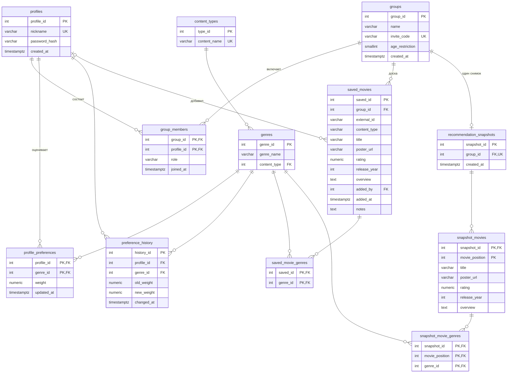
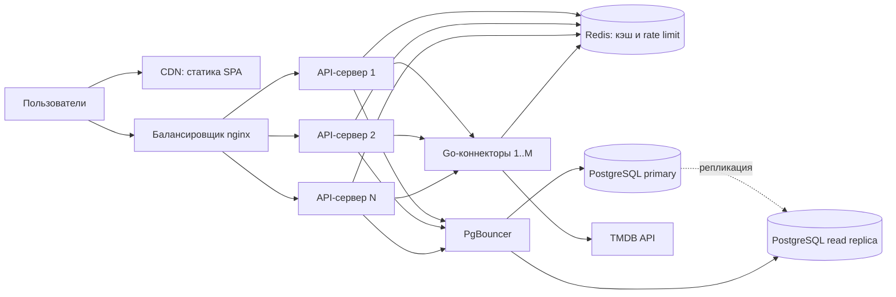

# CoPick

> **Ваш надежный напарник в мире развлечений**

Веб-сервис для совместного подбора фильмов в компании: каждый участник группы отмечает свои любимые и нелюбимые жанры, а сервис собирает из этого подборку, подходящую всем.

## Участники

| ФИО | Группа |
|-----|--------|
| Гаврилова Полина Вальерьевна | 5130904/40105 |
| Карнаухова Александра Кирилловна | 5130904/40105 |
| Костюков Михаил | 5130904/40105 |
| Шапков Гордей | 5130904/40105 |

---

## 1. Определение проблемы

Когда компания из 3–10 человек выбирает фильм, каждый предлагает своё, и на спор уходит 30–40 минут. Мессенджеры не агрегируют предпочтения участников и не показывают, какой вариант подходит большинству. В итоге выбор делается наугад или по настойчивости самого активного, а остальные остаются недовольны.

---

## 2. Выработка требований

### Пользовательские истории

1. **Когда** я собираюсь посмотреть фильм с друзьями, **я хочу** создать группу и позвать участников по короткому коду, **чтобы** все оказались в одном пространстве без обмена личными данными.
2. **Когда** я захожу в сервис, **я хочу** оценить жанры от «категорически не нравится» до «обожаю», **чтобы** сервис учитывал мои вкусы при выборе для группы.
3. **Когда** кто-то из группы находит интересный фильм, **я хочу** добавить его на общую доску группы с постером, рейтингом и описанием, **чтобы** все видели варианты в одном месте.
4. **Когда** вся группа оценила жанры, **я хочу** получить подборку фильмов, подходящих всем участникам (при желании выбрав, кто сегодня смотрит и какие жанры хочется именно сегодня), **чтобы** не тратить время на споры.
5. **Когда** состав компании меняется, **я хочу**, чтобы владелец мог исключать участников и обновлять код приглашения, **чтобы** контролировать, кто видит данные группы.

### Оценка нагрузки (допущения)

| Параметр | Значение |
|----------|----------|
| Активных пользователей в сутки (DAU) | 10 000 |
| Зарегистрированных профилей | ~50 000 |
| Запросов на пользователя в сутки | ~30 |
| Период хранения данных | > 5 лет |

---

## 3. Архитектура и детальное проектирование

### 3.1. Характер нагрузки

**Запросы.** 10 000 DAU × 30 запросов = 300 000 запросов/сутки ≈ **3,5 RPS** в среднем. Вечерний пик (пятница) примерно в 10 раз выше, то есть **~35 RPS**.

**Соотношение R/W ≈ 90 / 10.** Пользователи в основном просматривают группы и доску и значительно реже меняют предпочтения или добавляют фильмы.

**Трафик.** Средний ответ API около 5 КБ (изображения грузятся браузером напрямую с CDN TMDB по `poster_url` и через сервис не проходят). 300 000 × 5 КБ ≈ **1,5 ГБ/сутки** исходящего трафика, в пике около 175 КБ/с.

**Объём хранилища (5 лет).**

| Таблицы | Оценка | За 5 лет |
|---------|--------|----------|
| `profiles`, `groups`, `group_members` | 50 000 профилей, ~20 000 групп, малый размер строк | < 100 МБ |
| `profile_preferences` | 50 000 × ~15 жанров × ~50 Б | ~40 МБ |
| `preference_history` | ~20 000 записей/сутки × ~80 Б ≈ 1,6 МБ/сутки | ~3 ГБ |
| `saved_movies` + `saved_movie_genres` | ~5 000 добавлений/сутки × ~1,5 КБ (с `overview`) ≈ 7,5 МБ/сутки | ~14 ГБ |
| `recommendation_snapshots` и связанные | один снимок на группу: ~20 000 × ~10 фильмов × 1,5 КБ | ~0,3 ГБ |
| Индексы и накладные расходы | ×1,5 | |
| **Итого** | | **≈ 25 ГБ** |

Такой объём помещается на одном узле PostgreSQL.

### 3.2. C4. Диаграмма контекста (уровень 1)


Пользователь работает с CoPick через браузер. Единственная внешняя система — TMDB API, источник метаданных о фильмах (названия, постеры, рейтинги, описания, жанры).

### 3.3. C4. Диаграмма контейнеров (уровень 2)


| Контейнер | Технологии | Ответственность |
|-----------|-----------|-----------------|
| Веб-клиент | React, TypeScript, Vite, Tailwind CSS, Axios | Интерфейс управления группами, предпочтениями, доской и просмотра рекомендаций |
| API-сервер | Java 17, Spring Boot 3, Spring Security, Spring Data JPA, Hibernate | Бизнес-логика, JWT-аутентификация, права доступа, алгоритм рекомендаций, REST API |
| Connector | Go 1.26.0 | Загрузка и кэширование метаданных из TMDB |
| База данных | PostgreSQL | Профили, группы, предпочтения и их история, доска, снимки рекомендаций |

Коннектор вынесен в отдельный сервис, чтобы медленные сетевые вызовы к внешнему API не занимали потоки основного Java-бэкенда, а ключ и лимиты TMDB были изолированы в одном месте.

### 3.4. Контракты API и нефункциональные требования

Базовый префикс: `/api/v1`. Все эндпоинты, кроме `/auth/register` и `/auth/login`, требуют `Authorization: Bearer <JWT>`. Идентификатор текущего профиля берётся из токена.

| Метод | Путь | Описание | Права | Ответ | Целевое p95 |
|-------|------|----------|-------|-------|-------------|
| POST | `/auth/register` | Регистрация (`nickname`, `password`) | все | 201, `{token, profile}` | 300 мс |
| POST | `/auth/login` | Вход | все | 200, `{token, profile}` | 300 мс |
| PATCH | `/auth/me` | Смена никнейма и/или пароля (`nickname`, `oldPassword`, `newPassword`) | владелец профиля | 200, `ProfileDto` | 300 мс |
| GET | `/genres` | Справочник жанров | авторизованный | 200, список | 50 мс |
| GET | `/profiles/me/preferences` | Мои оценки жанров | авторизованный | 200, список | 100 мс |
| PUT | `/profiles/me/preferences` | Задать оценки жанров списком (вес от -1.0 до 1.0) | авторизованный | 200, список | 200 мс |
| DELETE | `/profiles/me/preferences/{genreId}` | Удалить одну оценку | авторизованный | 204 | 100 мс |
| DELETE | `/profiles/me/preferences` | Удалить все оценки | авторизованный | 204 | 100 мс |
| GET | `/groups` | Мои группы (роль, число участников) | авторизованный | 200, список | 150 мс |
| POST | `/groups` | Создать группу (`name`, `ageRestriction`) | авторизованный | 200, `GroupDetailsDto` | 200 мс |
| POST | `/groups/join` | Вступить по коду (`inviteCode`) | авторизованный | 200, `GroupDetailsDto` | 200 мс |
| GET | `/groups/{id}` | Детали группы и участники | член группы | 200, `GroupDetailsDto` | 150 мс |
| DELETE | `/groups/{id}` | Удалить группу | owner | 204 | 200 мс |
| DELETE | `/groups/{id}/members/{memberProfileId}` | Исключить участника | owner | 204 | 150 мс |
| POST | `/groups/{id}/regenerate-invite` | Новый код приглашения | owner | 200, `{inviteCode}` | 150 мс |
| POST | `/groups/{id}/leave` | Покинуть группу | член группы | 204 | 150 мс |
| GET | `/groups/{groupId}/saved` | Доска группы | член группы | 200, список | 250 мс |
| POST | `/groups/{groupId}/saved` | Добавить фильм на доску | член группы | 201, `SavedMovieResponseDto` | 300 мс |
| DELETE | `/groups/{groupId}/saved/{savedId}` | Убрать фильм с доски | член группы | 204 | 150 мс |
| GET | `/groups/{id}/recommendations` | Расчёт подборки. Параметры: `genreIds` (жанры «на сегодня»), `profileIds` (кто смотрит; по умолчанию вся группа), `limit` (по умолчанию 10) | член группы | 200, список `ScoredMovie` (`movieId`, `finalScore`, `genreIds`, `qualityScore`) |  800 мс |
| GET | `/groups/{id}/recommendations/stats` | Статистика группы: число участников, топ жанров (средний и минимальный вес), запрещённые жанры | член группы | 200, `GroupStatsResponse` | 300 мс |
| GET | `/groups/{id}/recommendations/last` | Последний сохранённый снимок рекомендаций с постерами, рейтингами и жанрами | член группы | 200, список `SnapshotMovieResponse` | 200 мс |

**Пример: добавление фильма на доску**

```http
POST /api/v1/groups/42/saved
Authorization: Bearer <JWT>

{ "externalId": "603", "contentType": "movie", ... }

201 Created
{
  "savedId": 17,
  "groupId": 42,
  "externalId": "603",
  "contentType": "movie",
  "title": "Матрица",
  "originalTitle": "The Matrix",
  "posterUrl": "https://image.tmdb.org/...",
  "rating": 8.2,
  "releaseYear": 1999,
  "genres": ["Боевик", "Фантастика"],
  "addedByProfileId": 5,
  "addedByNickname": "neo",
  "addedAt": "2026-11-10T19:00:00+01:00"
}
```

**Коды ошибок:** `400` — невалидные данные, `401` — нет или просрочен JWT, `403` — нет прав (не owner или не член группы), `404` — группа или запись не найдены, `409` — конфликт (дубликат на доске, занятый никнейм).

**Общие нефункциональные требования**
- p95 для чтения ≤ 300 мс при 35 RPS;
- доступность 99%;
- пароли хранятся как хэши (`password_hash`), аутентификация без состояния (JWT);
- ошибка внешнего API (TMDB) не должна ломать остальной функционал: чтение групп, доски и предпочтений работает без коннектора.

### 3.5. Алгоритм рекомендаций

Алгоритм (`CoPickAlgorithm`) работает в памяти API-сервера и не обращается к БД: все данные ему передаются на вход.

**Вход**
- оценки жанров участников (`genreWeights`, вес от -1 до 1; `profileIds` позволяет выбрать, кто сегодня смотрит, по умолчанию вся группа);
- жанры контекста (`genreIds`): то, чего группе хочется именно сегодня;
- кандидаты: фильмы с жанрами и рейтингом TMDB (`MovieCandidate`);
- флаг диверсификации (MMR).

**Шаг 1. Личная оценка фильма участником.** Берётся среднее по весам жанров фильма (жанры, которые участник не оценил, дают 0) и добавляется штраф за самый нелюбимый жанр:

```
personal = max(-1, mean(w_g) + λ · min(0, min w_g))
```

Вето: если участник поставил жанру ровно -1, а жанр не входит в контекст, фильм получает для этого участника `-1` сразу. Если такой жанр в контексте, вето смягчается: вес заменяется на `-κ`.

**Шаг 2. Групповая оценка.** Баланс между «хорошо в среднем» и «никого не обидеть»: берётся среднее личных оценок и среднее оценок самой недовольной четверти группы (`k = max(1, n/4)` худших оценок):

```
group = α · mean(personal) + (1 − α) · mean(худшие k оценок)
```

**Шаг 3. Итоговый скор.** К групповой оценке добавляются бонус за совпадение с жанрами контекста и поправка на качество фильма (рейтинг TMDB от 0 до 10 приводится к диапазону от -0.5 до 0.5):

```
final = group + β · [есть жанр из контекста] + ρ · (rating − 5) / 10
```

Фильмы сортируются по `final` по убыванию, при равенстве — по качеству, затем по `movieId` (детерминированный порядок).

**Шаг 4 (опционально). Диверсификация MMR.** Чтобы в топе не оказалось десяти похожих боевиков, берётся верхний пул из `M` фильмов, скоры нормируются в диапазон [0; 1], и фильмы выбираются жадно:

```
mmr = μ · score_norm − (1 − μ) · max(Jaccard(жанры фильма, жанры уже выбранных))
```

**Профиль группы** (`/recommendations/stats`): средний вес каждого жанра по группе, список запрещённых жанров (хотя бы у одного участника вес -1 и жанра нет в контексте) и коэффициенты влияния, то есть доли положительных средних весов, сумма которых равна 1.

**Гиперпараметры** (`AlgorithmConfig`):

| Параметр | Смысл |
|----------|-------|
| α | вес среднего против «худшей четверти» в групповой оценке |
| β | бонус за жанр контекста |
| ρ | вес рейтинга TMDB |
| λ | штраф за самый нелюбимый жанр |
| κ | смягчённый вес для вето-жанра из контекста |
| μ | баланс релевантности и разнообразия в MMR |
| M | размер пула для MMR |

### 3.6. Схема базы данных



На схеме для краткости опущены часть полей `saved_movies` и `snapshot_movies` (`original_title`, `backdrop_url`). Схема создаётся SQL-миграциями через `golang-migrate`; справочники `content_types` и `genres` (19 жанров для `movie`) заполняются начальной миграцией.

**Ограничения и целостность**
- `profiles.nickname`, `groups.invite_code` — `UNIQUE`; `genres` — `UNIQUE (genre_name, content_type)`.
- Проверки значений: `profile_preferences.weight` и `preference_history.old_weight/new_weight` — `CHECK (between -1 and 1)`, `groups.age_restriction` — `CHECK (between 0 and 21)`.
- Защита от дублей: `saved_movies` — `UNIQUE (group_id, external_id, content_type)`, `recommendation_snapshots.group_id` — `UNIQUE`.
- `ON DELETE CASCADE`: при удалении группы чистятся участники, доска и снимок; при удалении профиля — членство, оценки и история; при удалении жанра — связанные оценки и связи.
- `ON DELETE SET NULL`: `saved_movies.added_by`, то есть фильм остаётся на доске группы, если добавивший его профиль удалён.
- Роль участника (`owner` / `member`) хранится в `group_members.role`, владелец группы определяется ею.
- Жанры нормализованы: связи «фильм — жанр» хранятся в отдельных таблицах, без строк с перечислением.

**Почему схема выдерживает нагрузку.** При ~35 RPS в пике и ~25 ГБ данных за 5 лет все основные запросы идут по первичным или составным ключам и обслуживаются индексами. Списки с вложенными сущностями (доска с жанрами и авторами) загружаются через `@EntityGraph` и `JOIN FETCH`, что исключает проблему N+1. Метаданные фильма копируются в `saved_movies` и `snapshot_movies`, поэтому показ доски и рекомендаций не требует обращения к TMDB: это сознательная денормализация в обмен на скорость чтения и независимость от внешнего API. Самая быстрорастущая таблица, `preference_history`, работает только на добавление и читается по `profile_id`, её при необходимости можно партиционировать по времени.

### 3.7. Масштабирование при росте нагрузки в 10 раз

Цель: 100 000 DAU, ~350 RPS в пике, ~250 ГБ данных за 5 лет.



1. **API-серверы горизонтально.** Сервис не хранит состояние (JWT), а алгоритм рекомендаций считается в памяти без обращения к БД, поэтому нагрузка равномерно делится между 3–4 репликами за балансировщиком.
2. **База данных.** Пул соединений через PgBouncer; чтения (группы, доска, снимки) уходят на read-реплику, запись остаётся на primary (при R/W = 90/10 это снимает основную нагрузку). `preference_history` партиционируется по месяцам.
3. **Кэш.** Redis для справочника жанров, метаданных TMDB и rate limiting: меньше обращений к БД и внешнему API.
4. **Коннектор.** Масштабируется независимо (лёгкие Go-реплики), лимиты запросов к TMDB контролируются централизованно.
5. **Статика.** SPA отдаётся через CDN, нагрузку на бэкенд не создаёт.
6. **Дальнейший рост.** Шардирование по `group_id` и брокер сообщений для асинхронного пересчёта снимков рекомендаций.

---

## 4. Кодирование и отладка

| Компонент | Технологии |
|-----------|-----------|
| Web-Client | React, TypeScript, Vite, Tailwind CSS, Axios |
| Backend | Java 17, Spring Boot 3, Spring Security, Spring Data JPA, Hibernate |
| Connector | Go 1.26.0 |
| База данных | PostgreSQL, миграции `postgres_migrate` |

Структура репозитория:

```
/backend      # Spring Boot (пакеты auth, profiles, groups, preferences, saved, recommendations)
/web          # React SPA
/connector    # Go-сервис для TMDB
/migrator     # SQL-миграции
/monitoring   #Сбор метрик и алертинг
/test         #Интеграционное и нагрузочное тестирование
docker-compose.ayml
```

Ключевые решения:
- проверка прав на уровне сервисного слоя (только owner удаляет группу и исключает участников, владельца через эндпоинт исключить нельзя, членство проверяется перед просмотром группы и доски);
- алгоритм рекомендаций с «справедливой» групповой оценкой (учитывает самых недовольных участников), вето на нелюбимые жанры и диверсификацией выдачи (MMR);
- уникальный 8-значный код приглашения с возможностью перевыпуска владельцем;
- `@EntityGraph` / `JOIN FETCH` против N+1;
- целостность данных обеспечивается каскадами на уровне БД;
- тяжёлые обращения к внешнему API вынесены в отдельный Go-сервис.

---

## 5. Unit-тестирование

Тесты изолированы: не требуют БД, Docker и Spring-контекста. Репозитории и внешние сервисы подменяются моками (Mockito, mockery), HTTP эмулируется заглушками.

**Запуск**

```bash
cd backend && mvn test         # JUnit 5 + Mockito + AssertJ
cd connector && go test ./...  # testify

cd backend && mvn verify       # отчёт покрытия JaCoCo находится в target/site/jacoco/index.html
```

Те же команды выполняются в CI на каждый push/PR в main.

**Backend** — покрытие 80% по строкам (175 unit-тестов), структура повторяет основные пакеты:

- **Сервисы**: генерация и перевыпуск invite-кода; права — владельца нельзя исключить, не-владелец не может удалить группу, не-участник не видит группу и доску; передача владения при уходе владельца и удаление группы при уходе последнего участника; валидация никнейма/пароля и хэширование пароля.
- **Алгоритм рекомендаций**: вето на жанр и его смягчение для жанра из контекста; детерминированная сортировка при равных скорах; пустые кандидаты/участники; валидация параметров конвейера.
- **Контроллеры**: HTTP-статусы и коды ошибок через (400/401/403/404/409, 500 без раскрытия внутренних деталей).
- **Auth**: JWT — просроченный токен, чужой ключ, испорченная строка; фильтр извлекает Bearer-токен и не ломает запрос при невалидном токене.
- **ConnectorClient**: обмен с коннектором и обработка его ошибок на HTTP-заглушке.

**Connector** — httptest-заглушка (маппинг ответа, ошибки API, пустая выдача, невалидные даты); HTTP-хендлеры с моком `Fetcher` — валидация запросов и маппинг ошибок.

---

## 6. Интеграционное тестирование

Тест покрывает пользовательскую историю **«Регистрация и создание группы»** и проверяет всю цепочку: HTTP API → бизнес-логика → фактическое состояние базы данных.

### Сценарий

| № | Шаг | Что проверяется |
|---|-----|-----------------|
| 1 | Генерация уникальных учётных данных: никнейм с текущим Unix-таймстампом и надёжный пароль | Идемпотентность: тест можно запускать повторно без конфликтов |
| 2 | `POST /api/v1/auth/register` | Успешный статус ответа; из JSON извлекается JWT-токен |
| 3 | `POST /api/v1/groups` с названием «Тестовая группа sqlx» и возрастным ограничением 18, токен передаётся в заголовке `Authorization` | Успешный статус ответа; из JSON извлекается `groupId` созданной группы |
| 4 | Прямой SQL-запрос к PostgreSQL: `SELECT group_id, name, invite_code, age_restriction FROM groups WHERE group_id = $1` | Запись физически сохранена в базе |
| 5 | Сравнение данных из БД с данными из ответа API | Совпадают ID и название, `invite_code` не пустой, `age_restriction` корректен |
| 6 | Очистка в блоке `t.Cleanup`: транзакция `BEGIN` → `DELETE FROM groups` → `DELETE FROM profiles` → `COMMIT` | Тестовые данные удаляются, даже если один из предыдущих ассертов упал |

### Реализация

- **Окружение:** тестовый профиль `docker-compose` (`integration_tests`).
- **Язык и контейнер:** Go, отдельный контейнер `integration_tests`.
- **Запросы к API:** стандартная библиотека `net/http`; тест отправляет реальные сетевые запросы к работающему Spring Boot бэкенду.
- **Проверка БД:** библиотека `sqlx` (драйвер `lib/pq`) для прямой верификации состояния PostgreSQL.

### Запуск

```bash
# 1. Запуск инфраструктуры (postgres, backend)
docker compose up -d

# 2. Запуск интеграционных тестов
docker-compose --profile integration_tests run --rm integration_tests
```
---
## 7. Мониторинг, алертинг и нагрузочное тестирование
Для контроля состояния системы и выявления узких мест реализован контур наблюдаемости.

Стек мониторинга:
| Компонент | Назначение |
|---|---|
| Prometheus | Сбор и хранение метрик с интервалом 10 секунд (scrape) |
| Grafana | Визуализация метрик (дашборды JVM, HTTP-трафика и бизнес-логики) |
| Alertmanager | Оценка правил (SLO) и маршрутизация уведомлений |
| k6 | Генерация контролируемой нагрузки для проверки устойчивости |

### Метрики
Бэкенд экспортирует данные через эндпоинт /actuator/prometheus (Micrometer):
- Системные: использование JVM Heap, количество активных потоков, HTTP-запросы (count, latency p95/p99).
- Бизнес-метрики: copick_recommendation_duration_seconds (время генерации алгоритмом итоговой подборки фильмов).

### Алертинг
Правила срабатывания описаны в monitoring/rules.yml. Например, алерт HighRequestRate или HighRecommendationLatency переходит в статус FIRING при превышении заданных порогов (например, > 50 RPS или среднее время ответа > 2 с в течение 30 секунд). 
Уведомления доставляются в Telegram: Alertmanager отправляет webhook на специальный контроллер бэкенда, который форматирует сообщение и пересылает его через Telegram Bot API.

### Нагрузочное тестирование
Сценарий теста (tests/load_test.js) имитирует пиковый вечерний трафик, создавая постепенный рост числа виртуальных пользователей и проверяя время отклика API. Тест изолирован и запускается через отдельный профиль Docker Compose, не требуя установки k6 на хост-машину.

Запуск нагрузочного теста:
```bash
docker-compose --profile loadtest up loadtest
```
---
## 8. Сборка и запуск

```bash
git clone [ссылка]
cd copick
cp .env.example .env     # TMDB_API_KEY, JWT_SECRET, JWT_DURATION, TELEGRAM_BOT_TOKEN, TELEGRAM_CHAT_ID
docker compose up --build
```

После запуска:

- Frontend: http://localhost:4200.
- Backend API: http://localhost:8080/api/v1.
- Grafana: http://localhost:3000.

Сервисы в `docker-compose.yml`: `postgres`, `postgres_migrate`, `connector`, `backend`, `web`, `prometheus`, `alertmanager`, `grafana`.

